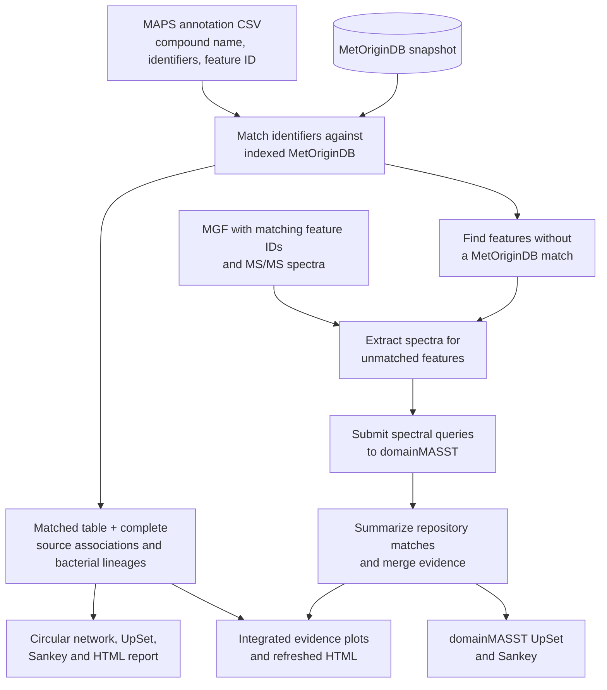

# MetOrigin and domainMASST Recorded Source Associations

Match metabolite annotations against a local MetOriginDB snapshot, retain all recorded source associations and bacterial lineages, and generate circular networks, UpSet plots, association diagrams and an interactive report. Optional domainMASST tools support a separate MS/MS spectral-occurrence workflow.

**These are recorded source associations, not definitive biological origins.** A human-only association means only human evidence is recorded under the matching criteria; it does not establish exclusive human production. Blood, urine and faeces are occurrence sites, not necessarily sites of synthesis.

## Start here

This guide assumes you have a MAPS annotation CSV for **one LC-MS/MS dataset** and its matching MGF file. Use **Windows PowerShell** in the repository folder. The MGF is needed for domainMASST; MetOrigin uses the annotation CSV and MetOriginDB.

| Your goal | What to run | Main result |
| --- | --- | --- |
| Match annotations to MetOriginDB | [Steps 1-3](#step-1-install-the-tools) | Recorded source associations, bacterial lineages, plots and HTML |
| Search public spectra for features MetOrigin did not match | [Steps 1-4](#step-1-install-the-tools) | domainMASST search results and merged evidence |
| View both evidence types together | [Steps 1-5](#step-1-install-the-tools) | Integrated plots and refreshed HTML |

A domainMASST search in this project begins with the **MetOrigin-unmatched** feature IDs. If you already have a completed MetOrigin run, start at Step 4.



MetOrigin matches **chemical identifiers** to a reference database. domainMASST looks for **spectral occurrences** in public data. Either result is evidence for follow-up; neither proves where a metabolite was made.

## Step 1. Install the tools

Install **Python 3.10** and R. Then open PowerShell in the repository folder. The examples below use the local Python at `.venv310\Scripts\python.exe`; run every command from the folder containing this README.

```powershell
git clone https://github.com/siyao4-byte/MetOrigin_MASST.git
Set-Location MetOrigin_MASST
py -3.10 --version
py -3.10 -m venv .venv310
.\.venv310\Scripts\python.exe -m pip install --upgrade pip
.\.venv310\Scripts\python.exe -m pip install -r requirements.txt
.\.venv310\Scripts\python.exe --version
```

If you already cloned the repository, start at `Set-Location`. You do not need to activate the environment. On a different computer, replace `py -3.10` with the full path to your installed Python 3.10 executable.

Plots use R. Set `$Rscript` to the **Rscript.exe on your computer**, then install the plotting packages once:

```powershell
$Rscript = 'C:\Program Files\R\R-4.5.1\bin\Rscript.exe'
Test-Path $Rscript
& $Rscript -e "install.packages(c('tidyverse', 'patchwork', 'yaml'), repos='https://cloud.r-project.org')"
```

`Test-Path` should print `True`. If it prints `False`, find your R installation with `Get-Command Rscript -ErrorAction SilentlyContinue` or set the correct full path. You can run MetOrigin matching without R, but plots require it.

## Step 2. Put the inputs in place

Download the original **MetOriginDB.csv** from the [TidyMass database page](https://www.tidymass.org/databases/). Keep the downloaded file unchanged. For this example, put these files at:

```text
data/
  maps/
    final-annotation-df.csv       Your MAPS table
  mgf/
    data_iimn_gnps.mgf            MGF from the same dataset
  metorigin/
    MetOriginDB.csv               Downloaded database snapshot
```

Create missing folders with `New-Item -ItemType Directory -Force data\maps, data\mgf, data\metorigin`, then place your files there. The folder and file names are examples; the next step lets you use another CSV path.

Check the MAPS CSV for a compound name or another usable key: `compound.name`, `smiles`, `CID`, `InChIKey`, `HMDB.ID` or `KEGG.ID`. The matcher accepts common spelling variants. **Input PubChem numbers are CIDs**, never SIDs. No confidence-level or MSNovelist filter is applied automatically; select the rows you intend to analyse before starting.

For domainMASST, the MAPS table must also have a **unique feature ID per row** (for example `feature.ID`). The MGF `SCANS` or `TITLE` must contain the same IDs. Check a few IDs in both files before a large search. If the table repeats feature IDs across rows or combines datasets with reused IDs, first prepare a dataset-specific, one-row-per-feature table and its corresponding MGF. The indexed matcher can use run-local row IDs when input IDs repeat, but those synthetic IDs will not match the MGF.

For MetOrigin alone, a combined MAPS total list is also acceptable: point `maps_annotation_file` to that CSV. Use a single-dataset table when you intend to continue to domainMASST.

## Step 3. Run MetOrigin

Make a private config copy and open it:

```powershell
Copy-Item config\config_total_annotations_metorigin.yaml config\sample.local.yaml
notepad config\sample.local.yaml
```

Set the following entries in that file. Keep it directly under `config/` and use forward slashes in its paths:

```yaml
maps_annotation_file: data/maps/final-annotation-df.csv
metorigin_file: data/metorigin/MetOriginDB.csv
metorigin_index: data/metorigin/sample-snapshot/metorigin.sqlite
input_pubchem_namespace: cid
allow_sid_fallback: false
output_file: runs/sample-01/outputs/metorigin_matches/MAPS_with_MetOriginDB_origin.csv
```

Keep the other options from the copied template. `sample.local.yaml` is ignored by Git. Choose a new `runs/...` folder for each new analysis; the matcher will not overwrite an existing result.

Run matching, plots and the HTML report together:

```powershell
.\.venv310\Scripts\python.exe scripts\run_indexed_workflow.py --config config\sample.local.yaml --plots --html --rscript "$Rscript"
```

The first run builds a searchable SQLite index from the unchanged database snapshot. Allow several tens of GB of free disk space for the index and complete evidence exports. Later runs can reuse that index. The default run validates input CIDs through PubChem; it sends CID numbers, not your MGF. To work without network access using previously cached CID validation, add `--offline`. Unvalidated CIDs are not silently accepted.

After completion, check:

```text
runs/sample-01/
  outputs/metorigin_matches/MAPS_with_MetOriginDB_origin.csv
  outputs/metorigin_matches/source_associations.csv
  outputs/metorigin_matches/bacterial_lineages.csv
  outputs/metorigin_matches/match_evidence.csv
  outputs/qc_reports/metorigin_matching_summary.csv
  Graph1_MetOrigin_R_outputs/
  interactive_origin_report.html
```

The main CSV has one row per input annotation. `metorigin_matched` says whether a database record matched. `from_human`, `from_bacteria` and related columns summarize recorded associations. Open `source_associations.csv` for individual database records and body-site/source details, `bacterial_lineages.csv` for complete organism-to-species taxonomy, and `match_evidence.csv` for accepted, rejected and conflicting candidate links. A match by name alone is weaker than structure-supported evidence. [Matching details](docs/indexed-workflow.md) explain the identifier rules.

## Step 4. Run domainMASST for unmatched MS/MS features

First install the upstream search code if `external\microbe_masst\code` is absent. The setup script checks Python 3.10 and clones the upstream repository:

```powershell
.\scripts\setup_domainmasst_python310.ps1
```

Set the run and MGF paths once. Use the **same dataset's MGF** as in Step 2:

```powershell
$run = 'runs/sample-01'
$mgf = 'data/mgf/data_iimn_gnps.mgf'
```

Prepare the query MGF **without submitting a search**:

```powershell
.\.venv310\Scripts\python.exe scripts\prepare_unmatched_ms2_domainmasst_merge.py --metorigin_csv "$run/outputs/metorigin_matches/MAPS_with_MetOriginDB_origin.csv" --mgf "$mgf" --out_dir "$run/outputs/domainmasst_unmatched_ms2"
```

Inspect `$run/outputs/domainmasst_unmatched_ms2/MetOrigin_unmatched_features_with_MS2_manifest.csv` and the companion MGF. Confirm that feature IDs and the number of spectra make sense. Only features with **no MetOriginDB match and an MS/MS spectrum in the MGF** are eligible. A zero-row manifest usually means there are no eligible spectra or the MAPS and MGF IDs do not agree.

The preparation command also writes a preliminary merged CSV. At this point, its `masst_searched` field marks spectra selected for search; it does **not** mean a public search finished. Use the merged CSV written after the `--run_masst` command for search results.

To search the public domainMASST service, run the same command with `--run_masst`:

```powershell
.\.venv310\Scripts\python.exe scripts\prepare_unmatched_ms2_domainmasst_merge.py --metorigin_csv "$run/outputs/metorigin_matches/MAPS_with_MetOriginDB_origin.csv" --mgf "$mgf" --out_dir "$run/outputs/domainmasst_unmatched_ms2" --run_masst
```

`--run_masst` **submits the selected MS/MS spectra to an external service**. The search can take considerably longer than local matching. The generated job and query log are kept in the domainMASST output folder. The default search is exact mode; see `--help` for cosine, mass tolerance, minimum matched signals, parallel-query and analog-mode options.

After the search finishes, make the tables used by the domainMASST plots:

```powershell
.\.venv310\Scripts\python.exe scripts\summarize_domainmasst_results.py --domainmasst_dir "$run/outputs/domainmasst_unmatched_ms2/domainMASST" --out_dir "$run/outputs/domainmasst_unmatched_ms2/testing_summary"
```

The key results are:

```text
runs/sample-01/outputs/domainmasst_unmatched_ms2/
  MetOrigin_unmatched_features_with_MS2.mgf
  MetOrigin_unmatched_features_with_MS2_manifest.csv
  domainMASST/                                         Raw public-search results
  testing_summary/                                    Counts and source-detail tables
  MAPS_with_MetOriginDB_plus_domainMASST_origin_evidence.csv
```

The merged CSV keeps MetOrigin identifier matches and domainMASST spectral-occurrence evidence in separate columns. domainMASST matches point to public spectra or datasets; they are not chemical-identification confidence levels or proof of biological production.

## Step 5. Draw both evidence types and open the report

Run this step after Step 4's search and summary. It generates the MetOrigin, domainMASST and integrated plots inside the same run folder, then refreshes the HTML report:

If you opened a new PowerShell window, set `$Rscript` and `$run` again as shown in Steps 1 and 4.

```powershell
$env:METORIGIN_RUN_DIR = $run
$env:METORIGIN_INCLUDE_DOMAINMASST = 'true'
& $Rscript scripts\Graph_All_compact_workflow.R
.\.venv310\Scripts\python.exe scripts\generate_interactive_origin_report.py --run "$run"
Start-Process "$run/interactive_origin_report.html"
```

The principal plots are:

| Folder | What to look for |
| --- | --- |
| `Graph1_MetOrigin_R_outputs/` | Circular source network, source-overlap UpSet and three-layer source/detail Sankey (PNG/PDF) |
| `Graph2_domainMASST_R_outputs/` | Public-occurrence UpSet and feature-to-domain-to-source Sankey (PNG and source CSVs) |
| `Graph3_integrated_origin_R_outputs/` | Combined UpSet, MetOrigin/domainMASST agreement matrix and integrated Sankey (PNG and source CSVs) |

Open `runs/sample-01/interactive_origin_report.html` in a browser. Use its source filters and search box to find a feature, then click its node or table row to inspect recorded source details and bacterial lineages. The report links to the complete CSV evidence tables. It loads Plotly from a CDN, so interactive plots require a network connection when opening the HTML.

For MetOrigin-only results, Step 3 already creates the HTML and Graph 1 plots. To redraw an existing run without rematching:

```powershell
$env:METORIGIN_RUN_DIR = 'runs/sample-01'
$env:METORIGIN_INCLUDE_DOMAINMASST = 'false'
& $Rscript scripts\Graph_All_compact_workflow.R
.\.venv310\Scripts\python.exe scripts\generate_interactive_origin_report.py --run runs/sample-01
```

## Common problems

- **`py -3.10` is not found:** Run `py -0p` to list installed Python paths. Install Python 3.10 or use its full executable path to create `.venv310`. Continue using `.\.venv310\Scripts\python.exe` for project commands.
- **R cannot be found:** Set `$Rscript` to your actual `Rscript.exe`. Matching and CSV export can still run without `--plots`.
- **No spectra are selected:** Check that `feature.ID` in the MAPS table matches MGF `SCANS` or `TITLE`, that IDs are unique for this dataset, and that unmatched features have MS/MS spectra.
- **The target MetOrigin CSV already exists:** Change `output_file` to a new `runs/...` folder. Existing runs are protected from overwrite.
- **The database snapshot changed:** Give the new CSV a new `metorigin_index` directory; an old index will fail its checksum check.
- **Few database matches:** Check the QC counts, identifier columns and `match_evidence.csv`. An unmatched entry is not evidence that the metabolite is novel or has no source.
- **Large HTML is slow:** Use the PNG/PDF plots and CSV files directly. HTML limits affect display only; the exported evidence remains complete.

For implementation and provenance details, see [indexed workflow](docs/indexed-workflow.md) and [folder structure](docs/folder_structure.md). Inputs, indexes, run outputs and private configs are ignored by Git.
